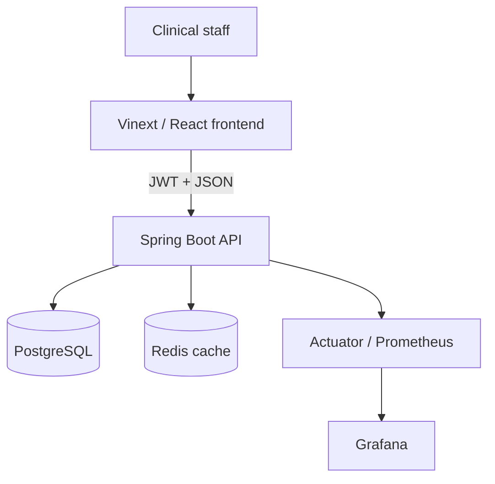

# Omya Hospital ERP

A production-oriented hospital operations platform with a polished clinical
dashboard and a secure Spring Boot API. It covers patient registration,
appointments, admissions, doctors, pharmacy inventory, prescriptions,
laboratory workflow, billing, subscriptions, audit history, and operational
reporting.

The hosted frontend can run in portfolio/demo mode without an API. When
`NEXT_PUBLIC_API_BASE_URL` is configured, it enables JWT login and loads live
dashboard, patient, appointment, and pharmacy data from the backend.

> This repository is an engineering portfolio and deployment baseline, not a
> compliance certification or a medical device. Complete a privacy review,
> threat model, penetration test, backup/restore drill, and jurisdiction-specific
> HIPAA/DPDP/GDPR controls before storing real patient data.

## What is implemented

- Responsive, keyboard-friendly clinical dashboard with nine operational modules
- Real backend integration for login, KPIs, patients, appointments, pharmacy,
  and patient registration
- Spring Boot 3.5 / Java 21 REST API with PostgreSQL and Redis
- Stateless JWT authentication, BCrypt password hashing, RBAC, strict CORS,
  request IDs, rate limiting, and safe structured errors
- Flyway-owned schema with foreign keys, checks, indexes, and concurrency
  constraints
- `BigDecimal` for all monetary values
- Pessimistic medicine stock locking plus PostgreSQL advisory locks for billing
  idempotency and multi-replica scheduled jobs
- Audit logs, PDF summaries, OpenAPI, Actuator, Prometheus, and Grafana
- Unit, validation, JWT, and Testcontainers concurrency tests
- Multi-stage non-root containers, Docker Compose, Kubernetes manifests, HPA,
  PDB, health probes, and read-only root filesystems
- GitHub Actions CI, CodeQL, Dependabot, and a k6 smoke/load scenario

## Architecture



| Layer | Technology | Responsibility |
|---|---|---|
| Frontend | React 19, TypeScript, Vinext | Responsive workflows, API session, demo fallback |
| API | Java 21, Spring Boot 3.5 | Validation, RBAC, domain rules, transactions |
| Data | PostgreSQL 16, Flyway | Durable records, constraints, locking, migrations |
| Cache | Redis 7 | Short-lived dashboard cache |
| Operations | Docker, Kubernetes, Prometheus, Grafana | Packaging, scaling, health, telemetry |

More detail is in [docs/architecture.md](docs/architecture.md).

## Run the complete stack

Prerequisites: Docker Engine with Compose v2.

1. Copy `.env.example` to `.env`.
2. Replace every placeholder. Generate the JWT secret with
   `openssl rand -base64 48`.
3. Start the stack:

```bash
docker compose up --build
```

Open:

- Frontend: `http://localhost:3000`
- API: `http://localhost:8080/api/v1`
- API docs: `http://localhost:8080/api/v1/swagger-ui/index.html`
- Management health: `http://localhost:9091/actuator/health` from inside the
  backend network/container

The local Compose profile creates one development administrator from
`DEV_ADMIN_USERNAME` and `DEV_ADMIN_PASSWORD`. It never ships a default
password, and production deployments should keep bootstrap disabled.

Start the optional observability profile:

```bash
docker compose --profile observability up --build
```

Prometheus is then available on port `9090` and Grafana on port `3001`.

## Frontend-only development

Requires Node.js `>=22.13`.

```bash
npm ci
npm run dev
```

With no `NEXT_PUBLIC_API_BASE_URL`, the UI uses representative demo records.
Set it to `http://localhost:8080/api/v1` before building to enable live mode.

## Backend development

Requires Java 21 and PostgreSQL 16.

```bash
cd backend
./mvnw spring-boot:run
```

Required environment variables are `DATABASE_PASSWORD` and `JWT_SECRET`.
Database migrations run automatically; Hibernate validates but never mutates
the production schema.

## Verification

```bash
npm run lint
npm test
cd backend && ./mvnw verify
docker compose config
```

Run the authenticated load scenario after starting the stack:

```bash
k6 run \
  -e API_USERNAME="$DEV_ADMIN_USERNAME" \
  -e API_PASSWORD="$DEV_ADMIN_PASSWORD" \
  load-tests/smoke.js
```

The k6 thresholds are acceptance targets, not claimed benchmark results.
Record hardware, dataset size, commit SHA, and observed percentiles before
putting performance numbers on a résumé.

## Deployment

- Frontend: deploy the repository root and provide
  `NEXT_PUBLIC_API_BASE_URL` at build time.
- Backend: deploy `backend/Dockerfile` with managed PostgreSQL and Redis.
- Kubernetes: replace the example image names, host, TLS secret, and secret
  values under `deploy/k8s`, then apply the manifests in order.
- Management telemetry is isolated on port `9091`; the public ingress only
  routes the application port.

See [docs/deployment.md](docs/deployment.md) for rollout, migration, rollback,
backup, and release-gate guidance.

## Security posture

Secrets are environment-only, tokens expire, passwords use BCrypt cost 12,
authorization is deny-by-default, and API failures do not expose stack traces.
Database constraints remain the final line of defense against concurrent
double-booking, overselling, and duplicate active subscriptions.

Read [docs/security.md](docs/security.md) before any production launch.
Vulnerability reporting guidance is in [SECURITY.md](SECURITY.md).

## Portfolio and résumé

Use only statements you can demonstrate in an interview. Suggested truthful
bullets and a measurement checklist are in
[docs/resume-bullets.md](docs/resume-bullets.md).
