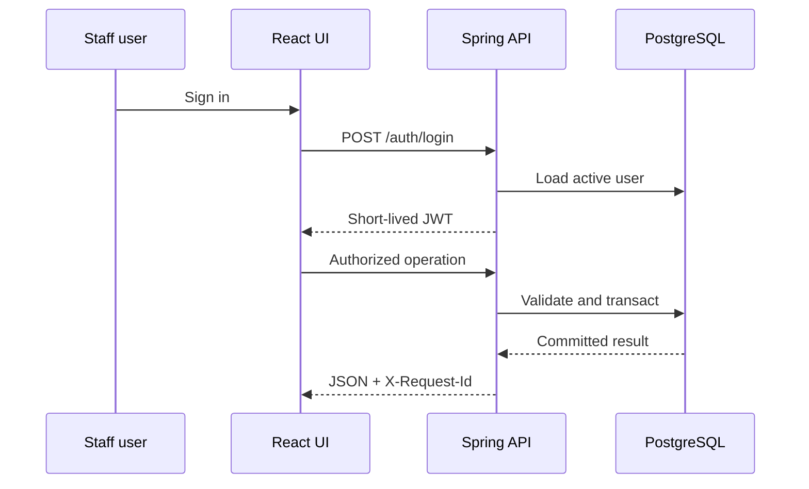

# Architecture

## Runtime boundaries

The browser holds the access token in React memory rather than persistent web
storage. Requests cross a versioned `/api/v1` boundary. Spring Security
authenticates the token, reloads the user active state, and enforces role rules
before controllers invoke transactional services.

## Consistency model

- Flyway is the sole schema owner; Hibernate runs with `ddl-auto=validate`.
- PostgreSQL foreign keys and check constraints protect referential and numeric
  integrity.
- A pessimistic row lock serializes medicine stock decrements.
- A transaction-scoped advisory lock serializes a billing idempotency key.
- Partial unique indexes prevent two active admissions for one bed and two
  active subscriptions for one patient.
- A PostgreSQL advisory lock lets only one application replica run subscription
  renewal for a given schedule.
- Audit records participate in the same transaction as the domain change.

## Failure handling

The API returns stable machine codes and safe user messages. Validation errors
are `400`, authentication failures `401`, authorization failures `403`, database
conflicts `409`, business-rule violations `422`, rate limits `429`, and
unexpected errors `500`. Server logs retain the exception with a request ID;
the response never includes a stack trace.

## Scaling

The API is stateless and can scale horizontally. PostgreSQL is the consistency
authority and Redis stores disposable dashboard cache entries. Kubernetes
includes resource requests/limits, readiness/liveness probes, an HPA, and a Pod
Disruption Budget. Production sizing still requires measured load tests.

